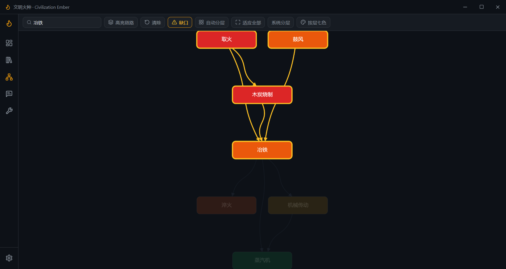
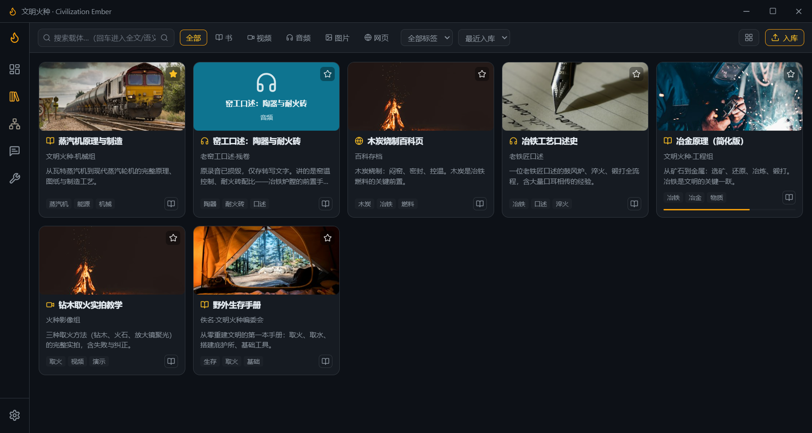
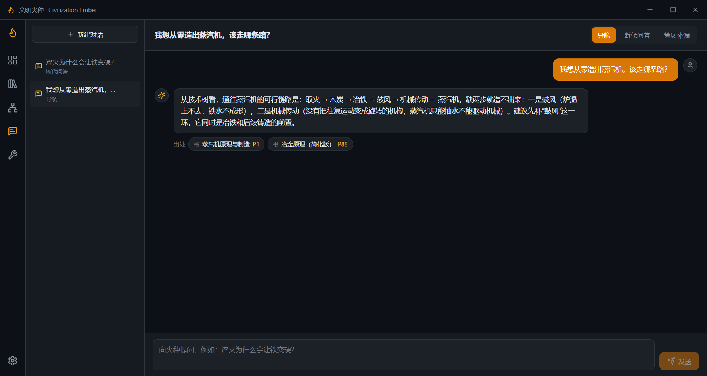
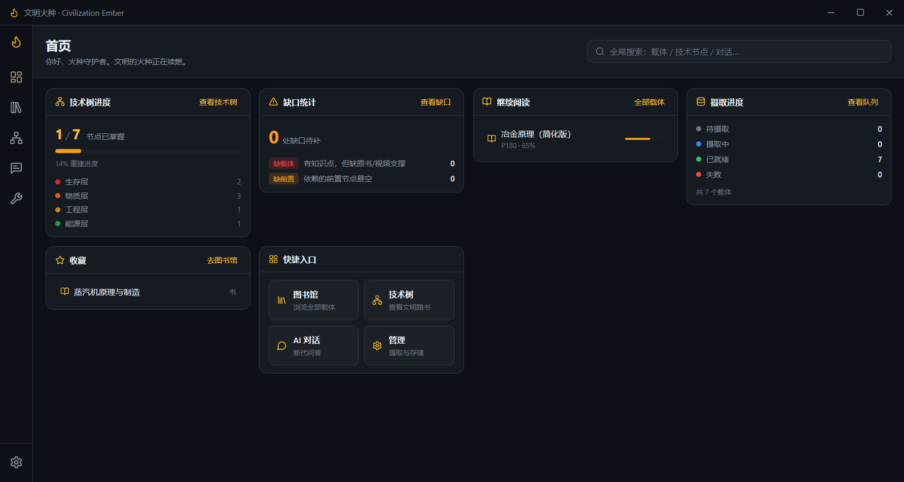
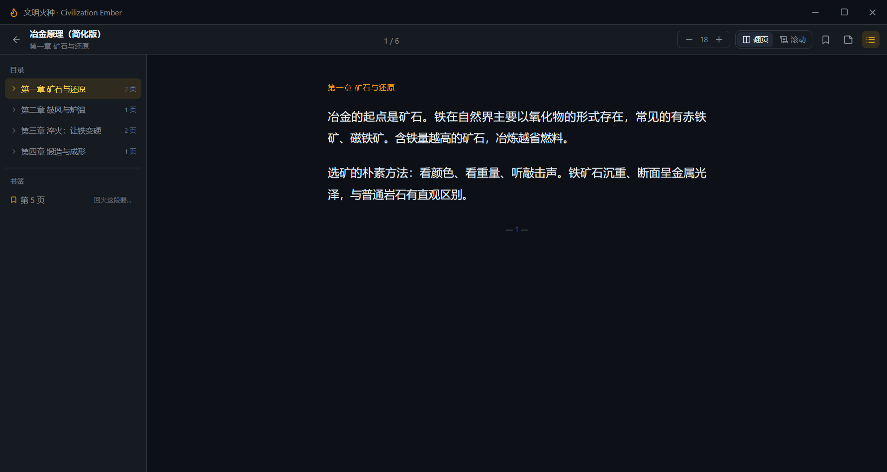
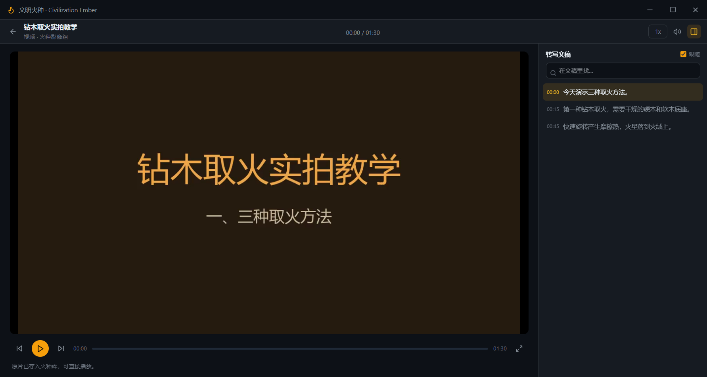
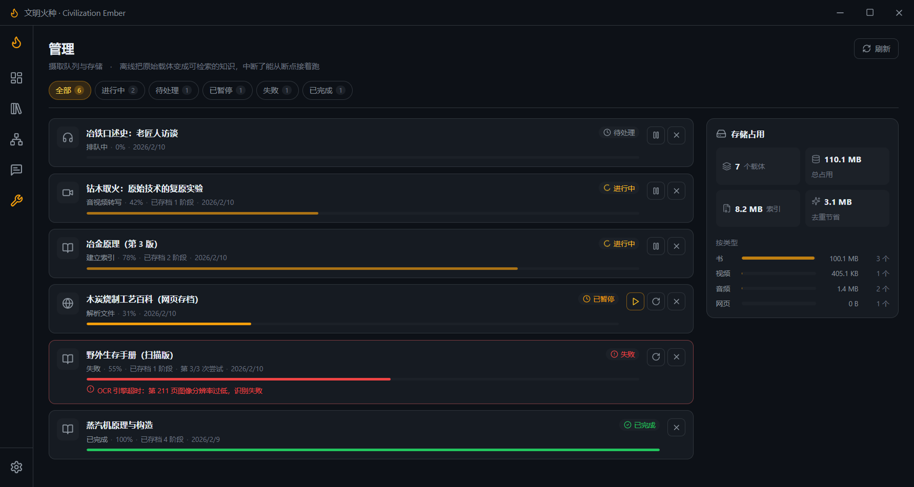
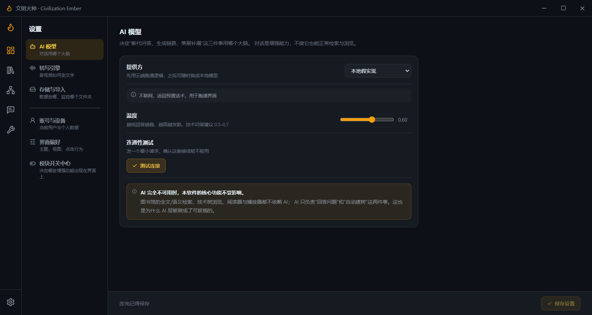

# 文明火种 · Civilization Ember

> 一场灾难之后，城市没了，书烧了，会写字的人也没了。剩下的幸存者要从零开始重建文明——
> 而这个软件，是他们在废墟里能找到的那座图书馆。

**Civilization Ember** 是一个科幻设定下的**文明知识库桌面应用**。它把散落在书本、影像、口述里的
"怎么活下去、怎么造东西"整理成一张可查、可读、可学的知识网络，
让断了代的人也能顺着链路一步步走下去：取火 → 木炭 → 冶铁 → 鼓风 → 机械传动 → 蒸汽机。

---

## 目录

- [它解决什么问题](#它解决什么问题)
- [八个页面](#八个页面)
- [技术栈](#技术栈)
- [快速开始](#快速开始)
- [目录结构](#目录结构)
- [几条设计原则](#几条设计原则)
- [当前状态（重要）](#当前状态重要)
- [后续规划](#后续规划)
- [许可](#许可)

---

## 它解决什么问题

普通的电子书库解决的是"存"的问题——把文件堆进去，能搜到标题就行。
但文明重建真正难的不是存，是**知道下一步该学什么**。

一个人捡到一本讲蒸汽机的书，他看不懂——不是字不认识，是他不知道
"为什么要先有鼓风炉"、"淬火为什么能让铁变硬"、"没有机械传动蒸汽机为什么只能抽水"。
缺的是**前置知识**。

所以这个软件的核心不是书架，是**技术树**：

- 每个知识点（节点）都标注了它属于哪个时代层级（L0 生存 → L6 计算）、依赖哪些前置节点、被哪些原书原片支撑
- 缺口能被主动发现：哪个节点有知识但没有原始载体支撑（"缺载体"）、哪个节点的前置是悬空的（"缺前置"）
- 任何一个节点，都能顺着链路回溯到最根源的那一步——你的祖先是怎么做到的
- 每条知识都能点回出处：哪本书第几页、哪个视频第几分几秒

一句话：**不只是让你查到答案，是让你知道通往答案的路。**

---

## 八个页面

### 技术树 `/tech-tree` — 核心

文明的路书。G6 Canvas 渲染的有向无环图，按七层时代分层排布。**这是整个软件的脊梁**，其余七页都围着它转。



- **链路高亮**：点"高亮链路"，从当前节点一路回溯到 L0 的起点，其余全部淡出
- **缺口视图**：缺载体（有知识没原书）、缺前置（依赖节点悬空）两类缺口直接标在图上
- **布局快照**：系统自动分层 ↔ 我的手动整理，两套布局随时切换，拖拽的位置会存下来
- **配色切换**：按时代分层七色 / 统一火种琥珀
- **详情面板**：前置依赖、后置解锁、引用载体、已掌握标记
- **从这里问 AI**：带着节点上下文跳到对话页

### 图书馆 `/library` — 载体库

书、视频、音频、图片、网页，五种形态统一管理。



- 卡片 / 列表双视图，单击右侧窄栏快看，双击进独立详情页
- **真的能入库**：选文件多选 / 监控文件夹（丢进去就自动收）/ 粘贴网址抓正文和配图
- 内容寻址去重：同一份内容导两次，第二次提示"已在库中"，磁盘上只存一份
- 全文检索 + 语义检索（搜"变硬"能命中"淬火"，靠的是近义词映射层）
- 星标收藏、阅读进度、按类型/标签过滤、多种排序
- 反向链接："这本书被哪些技术节点引用"——知识网络是双向的

### AI 对话 `/chat` — 问路者

撞到看不懂的地方，来这里问。



三种模式不是三个功能，是同一套能力的三种用法：

| 模式 | 你在问什么 | 它给你什么 |
|---|---|---|
| **导航** | "我想从零造出蒸汽机，该走哪条路？" | 技术树上算出的可行链路，每步标依赖和缺口 |
| **断代问答** | "淬火为什么会让铁变硬？" | 检索载体后的回答，**每条结论都带出处** |
| **策展补漏** | "帮我看看冶铁链还缺什么" | 缺口清单 + 该补哪类书 |

- 回答流式逐字输出（有代入感，不是等半天蹦一坨）
- 出处可点击：默认弹内嵌预览卡片，再点才跳转；也可在设置里改成直接跳
- 可从技术树/图书馆带上下文进来（`?nodeId=` / `?carrierId=`）

### 首页 `/dashboard` — 今天该干什么



- 六张卡片：重建进度、缺口统计、继续阅读、摄取进度、收藏、快捷入口
- 卡片可拖拽重排，每张可单独开关（存个人偏好）
- 顶部全局搜索：一次搜载体 + 技术节点 + 对话记录
- 卡片上直接带操作：暂停队列、去补缺口、接着上次读

### 阅读器 `/reader/:id` — 沉浸式

**这一页是用户明确要求重点做好的。**



- 翻页 / 连续滚动双模式，切换不丢位置
- 字号 15–22px 可调，键盘 ← → 翻页
- 目录按章跳转、书签可增删、每个载体单独记阅读进度
- **选中文字弹浮动工具条**：划线 / 写笔记，笔记面板统一管理，点页码跳回原处

### 播放器 `/player/:id` — 音视频 + 转写



- 视频、音频真播放，不是占位
- 右侧转写文稿按时间轴排列，播放时当前句自动高亮跟随
- **点某一句，播放头就跳到那一句**
- 倍速 0.75–2×、静音、±10s、全屏，进度按秒记

还专门做了一个边界形态：**没有原片的载体**。
当"片子已经没了、只剩当年记下的文字"，播放器显示的不再是播放器，
而是一句"**原片已遗失，知识还在**"加可点的时间轴文稿。
因为在文明断层里，这是常态而不是异常。

### 管理 `/admin` — 摄取队列



- 摄取任务全状态：排队 / 处理中 / 已暂停 / 失败 / 已完成，带阶段进度
- **断点续传**：暂停后继续，从上次存档的阶段接着跑，不从头再来
- 失败可重试、显示尝试次数和失败原因
- 右侧存储面板：总占用、索引体积、去重节省、按类型明细

### 设置 `/settings` — 六个页签



分两组，界限很清楚：

**整机设置**（这台机器共用，将来上 NAS 多用户也是同一套）
- AI 模型：提供商 / 接口 / 模型名 / 温度 / 连通性测试
- 转写引擎：引擎、设备（cuda/cpu）、语言、模型大小
- 存储与导入：数据目录、索引目录、监控文件夹开关

**个人设置**（每个用户各自独立）
- 账号与设备、界面偏好（主题、视图、点击行为）、模块开关中心

---

## 技术栈

| 层 | 选型 | 为什么 |
|---|---|---|
| 壳 | **Electron 33** | 要产出 Windows exe。相比 Tauri 不需要 Rust 工具链，且内置 Node，将来接 Python 转写进程（Whisper/OCR）更顺 |
| 构建 | electron-vite 3 + Vite 6 | 三进程（main/preload/renderer）一套配置搞定热更新 |
| 界面 | Vue 3.5 + TypeScript 5 + Tailwind 4 | Composition API + 完整类型推导 |
| 状态 | Pinia 2 | 每个页面一个 store，页面只负责"组装" |
| 路由 | Vue Router 4（hash 模式） | file:// 下 hash 模式不需要服务端 |
| 图 | AntV G6 5 | 技术树画布，可换 Cytoscape / Sigma（接口已抽象） |
| 图标 | lucide-vue-next | 线性风格，和整体调性一致 |

---

## 快速开始

```bash
# 需要 Node 20+ 与 pnpm
pnpm install
pnpm dev          # 开发（热更新）
```

```bash
pnpm build        # 构建
pnpm typecheck    # 类型检查（tsc + vue-tsc）
pnpm preview      # 预览构建产物
```

> **Windows 用户注意**
>
> 如果你的终端环境里预设了 `ELECTRON_RUN_AS_NODE=1`（某些 Electron 应用会把它泄漏给子进程），
> electron 会以纯 Node 模式启动并报 `Cannot read properties of undefined (reading 'whenReady')`。
> 启动前清掉它即可：
>
> ```powershell
> Remove-Item Env:ELECTRON_RUN_AS_NODE -ErrorAction SilentlyContinue
> ```
>
> 普通桌面终端和双击 exe 不受影响。

---

## 目录结构

```
civilization-ember/
├─ src/
│  ├─ main/index.ts            # 主进程：窗口、IPC、窗口控制
│  ├─ preload/                 # 安全桥接层（contextBridge，逐项显式暴露）
│  └─ renderer/
│     ├─ public/media/         # 音视频素材（打包时原样拷贝）
│     └─ src/
│        ├─ types/             # 全部 TS 类型定义（领域模型的唯一真相）
│        ├─ services/          # 服务接口层（纯接口，不含实现）
│        │  └─ graph/g6.ts     # G6 适配器（可替换）
│        ├─ mocks/             # Mock 实现 + 假数据（当前装配的就是这套）
│        ├─ stores/            # Pinia：每页一个 store
│        ├─ components/        # 按页面分目录的组件
│        ├─ pages/             # 页面（只负责组装，不含业务逻辑）
│        ├─ composables/       # 跨组件交互逻辑
│        ├─ lib/               # 纯函数（格式化、缺口检测、布局算法）
│        └─ assets/            # 设计系统 CSS + 本地封面
├─ docs/screenshots/
├─ electron.vite.config.ts
└─ package.json
```

---

## 几条设计原则

代码里有大量中文注释写明了"为什么这么做"，这里只列最关键的几条：

### 1. AI 可拔插，核心功能脱离 AI 独立成立

这不是一句口号，是架构约束。技术树浏览、图书馆检索、阅读器、播放器**全部不依赖 AI**。
AI 只负责两件事：回答问题和自动建树。所以 AI 层是一个接口，`mock` / 云端 API / 本地 Ollama
三种实现随便换，换掉之后软件的骨架一点不动。

设置页里那句提示是认真的：*"AI 完全不可用时，本软件的核心功能不受影响。"*

### 2. 双模式可插拔

凡是"有两种合理做法"的地方，不二选一，做成策略 + 设置项：
卡片/列表、翻页/滚动、右侧固定栏/抽屉、跳转/内嵌预览、按层七色/统一琥珀、系统布局/手动布局。
数据层和呈现形态解耦，切换只影响显示。

### 3. 功能可见性用 Feature Flags

收藏星标、标注划线、阅读进度这类**增强功能**都有独立开关，收在设置页"模块开关中心"。
**关掉只是隐藏，不删数据。** 用户哪天想开回来，东西还在。

### 4. 全局数据 vs 个人数据

一条很容易做错、但将来上多用户就救不回来的线：

| 全局共享（火种只有一份） | 个人数据（user_id 隔离） |
|---|---|
| 技术树节点与依赖 | 已掌握标记 |
| 载体与转写 | 阅读进度、书签、标注 |
| 布局系统预设 | 布局手动快照 |
| — | 主题、视图偏好、模块开关 |

同理，设置页把**整机设置**（AI/转写/存储）和**个人设置**（账号/界面/模块）分成两组——
因为将来 NAS 上多个用户共用同一套模型和同一块磁盘，但各自的主题和开关要独立。

### 5. 接口先行，Mock 顶上

八大服务接口（存储、AI、转写、摄取、设置、文档、媒体、图）先定死签名，
当前用内存 Mock 装配，接真实后端时只替换实现层，页面代码一行不改。

二期第 8 期起，**存储已经换成真的**：接口契约搬到了 `src/shared/contracts/storage.ts`，
主进程用 SQLite 实现、渲染进程通过 IPC 代理调用——签名一个字没改，
八个 store 和几十个组件零改动。这条原则第一次兑现。

第 9 期照同一套路兑现第二次：摄取与文档两个服务的契约搬到了
`src/shared/contracts/ingest.ts` 和 `src/shared/contracts/document.ts`，
主进程真实现（文件系统、哈希、网络、chokidar 都在主进程），渲染层只留一层薄代理。
界面那边一行调用没改。

---

## 当前状态（重要）

**这是一版完整可点的前端 + 已经能吃进真实文件、并把 PDF / EPUB 读成正文的知识库骨架。**
它还不是可用的产品：转写、OCR、真检索、真 AI 都还没接。

| 已完成 | 未完成 |
|---|---|
| ✅ 八个页面全部可运行、可交互 | ❌ 扫描版 PDF / 图片没有文字层（要等文字识别） |
| ✅ 技术树、阅读器、播放器、AI 对话全部走通 | ❌ Whisper 转写未接入（音视频还不能读成文字） |
| ✅ 音视频真能播放（素材是现做的） | ❌ 检索仍是朴素子串，没有倒排索引和 BM25 |
| ✅ **数据真的存得住**（SQLite，关掉再开还在） | ❌ AI 回答仍是预设话术，不是真模型 |
| ✅ **能真的导入文件了**（选文件 / 监控文件夹 / URL 抓取，内容寻址去重） | ❌ 还没打成 exe 安装包 |
| ✅ **TXT / Markdown / PDF / EPUB / 网页都能读成正文**，带目录与页码 | |
| ✅ 类型检查与构建零报错 | |

关于第 8 期做了什么：

- 存储层搬进主进程，用 `node-sqlite3-wasm`（免编译，不需要 VS 生成工具），
  数据落在 `%APPDATA%\civilization-ember\ember.db`
- 15 张表：载体、转写、技术树节点与边、布局快照、用户与偏好、
  阅读进度、标注、已掌握、收藏、书签、会话与消息
- 带 `schema_version` 的增量迁移机制，以后每期加字段走迁移脚本，**不清库**
- 复合主键 `(user_id, carrier_id)` 表达"个人数据归属"，
  将来上多用户是纯增量，不用改表
- 首次启动写入演示数据（7 个载体、技术树、一条阅读进度、一条标注、一个书签），
  之后你的任何改动都会留下来

关于第 9 期做了什么：

- **选文件导入**：`dialog` 多选，支持 pdf/epub/txt/md/音视频/图片；
  文件按 SHA-256 收进内容寻址对象仓 `objects/ab/cd/<hash>.<ext>`，同一份内容只存一次
- **监控文件夹**：`chokidar` 盯着一个目录，往里丢文件自动入库。
  用"连续两次采样大小相同"判断文件写完，而不是定时器等一段时间——
  复制 500MB 文件时大小可能几百毫秒不变，定时器会误判成已完成
- **URL 抓取**：`cheerio` 抽正文（优先 `article > main > [role=main] > body`），
  并把页面里的图片一并下载入库（上限 30 张、单张 8MB），
  正文按 1200 字一页切分、识别 Markdown 与"第 X 章"标题
- **去重**：重复导入不是错误，是去重生效的证据。界面显示"已在库中"而不是红色报错
- **自定义协议 `ember-object://`**：库里的文件不走 `file://` 绝对路径
  （那样一搬机器就全断，还会暴露磁盘结构），走自定义协议按哈希取；
  支持 `Range`，所以视频能拖进度条

关于第 10 期做了什么：

- **PDF 真解析**：`pdfjs-dist` 逐页抽文字层，中文字体靠 `cmaps` / `standard_fonts`
  还原编码（缺了它们中文会抽成乱码）。一页 PDF 就是一页书，不重新排版——
  重排会把图注和正文搅在一起，读者反而找不到位置
- **EPUB 真解析**：`jszip` 解包 → 读 `META-INF/container.xml` → 按 OPF 的
  **spine 顺序**读章节（不按文件名排，否则 `chapter10` 会排到 `chapter2` 前面）
- **扫描版如实说明**：整本没有文字层时明确报"这是一本扫描版 PDF（N 页里 M 页没有文字层），
  需要文字识别才能读，第 15 期接入"，而不是返回一本白页书。
  阅读器里也讲清楚原因，不会让你以为软件坏了
- 解析结果写回 `documents` 表，规模写进载体描述（"已解析 3 页"），图书馆列表直接可见

现在**可以**做的事：逛界面、加书签、把 `.txt` / `.md` / `.pdf` / `.epub` 或一个网页丢进去，
几秒后能在图书馆看到它、在阅读器里带目录真读完、关掉再开它还在。
现在**还不能**做的事：导一段录音或一本扫描件进去让它读懂。

---

## 后续规划

二期共 10 个子期（第 8–17 期），把 Mock 全部换成真实现，打包推迟到真正可用之后：

| 期 | 内容 | 状态 |
|---|---|---|
| 8 | 持久化地基：SQLite + 原文件仓 + IPC | ✅ 已完成 |
| 9 | 真摄取：选文件 / 监控文件夹 / URL 抓取 + 去重 | ✅ 已完成 |
| 10 | 文本解析：PDF / EPUB / TXT / 网页 → 统一文档结构 | ⬜ |
| 11 | 阅读器接真内容：PDF 逐页渲染保版式 | ⬜ |
| 12 | 关键词检索：中文 bigram + 倒排索引 + BM25 | ⬜ |
| 13 | 媒体与转写：faster-whisper 侧车 + 时间戳分段 | ⬜ |
| 14 | AI 真接入：真流式 + 三模式提示词 + RAG | ⬜ |
| 15 | OCR：扫描版书页识别 | ⬜ |
| 16 | 技术树接真数据：引用回链 + 真缺口检测 | ⬜ |
| 17 | 联调 / 压测 / 容错，然后才打包 | ⬜ |

三个里程碑：第 8 期末数据不再蒸发；第 12 期末能查到了（离线知识库成立）；
第 14 期末火种会说话了（Mock 彻底退场）。

一批"放后期"的增强项：AI 内嵌浮窗、更细的出处设置、拖窗口字体自适应、
NAS 多设备同步与备份。

跨平台说明：Windows 先做；Linux/macOS 后面用同一套 Electron 代码打包；
安卓/iOS 不是桌面系统，Electron 覆盖不了，需要另做一套，记在 backlog 不阻塞主线。

---

## 许可

[MIT](LICENSE)

---

<p align="center">
  <sub>火会灭，字会留下来。</sub>
</p>
